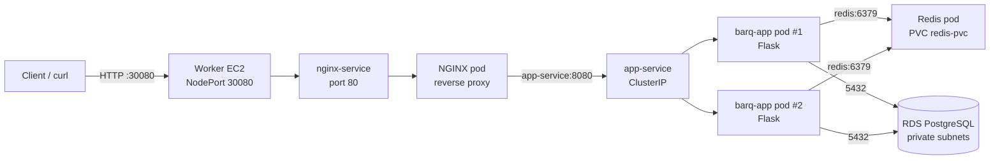
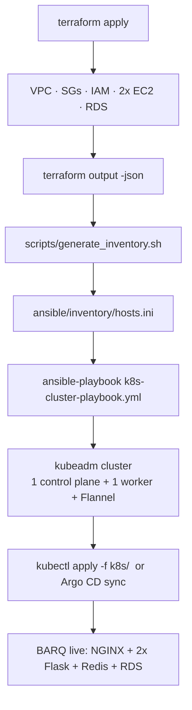
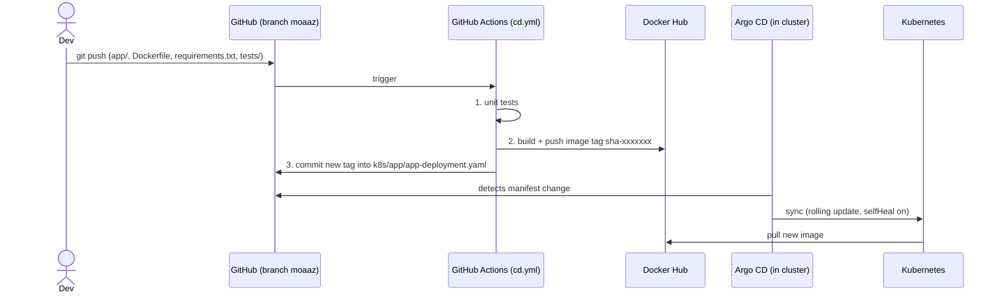

<div align="center">

# ⚡ BARQ — Automated AWS Infrastructure & Self-Managed Kubernetes

**Terraform provisions it. Ansible builds the cluster. Kubernetes runs it. GitHub Actions + Argo CD ship it.**


</div>

---

## 📖 Table of Contents

1. [What is this project?](#-what-is-this-project)
2. [Architecture](#-architecture)
3. [How the pieces talk to each other](#-how-the-pieces-talk-to-each-other)
4. [Repository structure](#-repository-structure)
5. [Prerequisites](#-prerequisites)
6. [Deployment guide (step by step)](#-deployment-guide-step-by-step)
7. [The BARQ application API](#-the-barq-application-api)
8. [Verification checklist](#-verification-checklist)
9. [CI/CD & GitOps](#-cicd--gitops)
10. [Redis storage — design & limitations](#-redis-storage--design--limitations)
11. [Security design](#-security-design)
12. [Troubleshooting](#-troubleshooting)
13. [Cleanup](#-cleanup)
14. [Known limitations & roadmap](#-known-limitations--roadmap)

---

## 🎯 What is this project?

BARQ is a small Flask API (PostgreSQL for records, Redis for a counter) deployed on a **self-managed Kubernetes cluster that runs on plain EC2 instances** — no EKS, no AKS. Everything is automated end to end:

| Layer | Tool | What it does |
|---|---|---|
| **Infrastructure** | Terraform | VPC, subnets, IGW, route tables, security groups, IAM, 2× EC2, RDS PostgreSQL |
| **Cluster** | Ansible | Prepares nodes, installs containerd + kubeadm/kubelet/kubectl, runs `kubeadm init`, installs Flannel, joins the worker |
| **Workloads** | Kubernetes | NGINX → 2× Flask → Redis (PVC) + external RDS |
| **Delivery** | GitHub Actions + Argo CD | Test → build → push image → bump manifest → auto-sync to the cluster |

**Design goals:** reproducible from zero, safe to re-run (idempotent), secrets and state never in Git, least-privilege networking.

---

## 🏗 Architecture

### 1. Network & infrastructure (what Terraform builds)

```text
                    Internet
                        │
              ┌─────────┴────────┐
              │ Internet Gateway │
              └─────────┬────────┘
                        │
┌─ VPC 10.0.0.0/16  ·  eu-central-1 ───────────────────────────────────────┐
│ ┌─ PUBLIC subnet 10.0.1.0/24 (AZ-a)  ·  0.0.0.0/0 -> IGW ──────────────┐ │
│ │ ┌─ EC2 control-plane ──────────┐    ┌─ EC2 worker ─────────────────┐ │ │
│ │ │ kubeadm · etcd               │    │ kubelet · containerd         │ │ │
│ │ │ kube-apiserver :6443         │    │ NGINX · Flask x2 · Redis     │ │ │
│ │ │ scheduler · ctrl-manager     │◄──►│ NodePort :30080              │ │ │
│ │ │ SG: barq-control-plane-sg    │    │ SG: barq-worker-sg           │ │ │
│ │ └──────────────────────────────┘    └──────────────────────────────┘ │ │
│ └──────────────────────────────────────────────────────────────────────┘ │
│                                                                          │
│ ┌─ PRIVATE db-subnet-1 (AZ-a) ───┐    ┌─ PRIVATE db-subnet-2 (AZ-b) ───┐ │
│ │ 10.0.2.0/24                    │    │ 10.0.3.0/24                    │ │
│ │ no route to internet           │    │ no route to internet           │ │
│ └────────────────────────────────┘    └────────────────────────────────┘ │
│                                                                          │
│ ┌─ RDS PostgreSQL  (DB subnet group spans both AZs) ───────────────────┐ │
│ │ barq-postgres · publicly_accessible=false                            │ │
│ │ SG: barq-rds-sg  <-  5432 only from worker SG                        │ │
│ └──────────────────────────────────────────────────────────────────────┘ │
└──────────────────────────────────────────────────────────────────────────┘
```

> CIDRs shown are the values from `terraform.tfvars.example`; all of them are variables.

### 2. Request path (what happens when someone calls the app)



### 3. Provisioning pipeline (how the pieces are chained)



---

## 🔌 How the pieces talk to each other

### Network flows (AWS level)

| # | From | To | Port | Purpose | Allowed by |
|---|---|---|---|---|---|
| 1 | Your IP (`allowed_ssh_cidr`) | Control plane + Worker | 22/tcp | SSH / Ansible | `*_ssh` ingress rules |
| 2 | Your IP (`allowed_ssh_cidr`) | Worker | 30080/tcp | App entry point (NGINX NodePort) | `worker_nodeport` rule |
| 3 | Worker SG | Control-plane SG | 6443/tcp | kubelet / kube-proxy → API server | `k8s_api` (SG → SG) |
| 4 | Control-plane SG | Worker SG | 10250/tcp | API server → kubelet (logs, exec) | `worker_kubelet` (SG → SG) |
| 5 | Control plane ↔ Worker | each other | 8472/udp | Flannel VXLAN (pod ↔ pod across nodes) | `flannel_*` (SG → SG) |
| 6 | Worker SG | RDS SG | 5432/tcp | Flask → PostgreSQL | `rds_postgres` (SG → SG) |
| 7 | Both nodes | Internet | all | apt, Docker Hub, GitHub (via IGW) | `*_egress` |

Nothing else is open. RDS has **no** public access and **no** route to the internet.

### Traffic flows (Kubernetes level)

| From | To | How it is addressed |
|---|---|---|
| Client | NGINX | `http://<worker-public-ip>:30080` (NodePort, the **only** exposed port) |
| NGINX | Flask pods | Service DNS `app-service:8080` → kube-proxy load-balances across both replicas |
| Flask | Redis | Service DNS `redis:6379` (from `REDIS_URL`) |
| Flask | PostgreSQL | RDS endpoint from `DATABASE_URL` (Kubernetes Secret) |
| Pod ↔ pod on different nodes | | Flannel VXLAN over UDP 8472 on pod CIDR `10.244.0.0/16` |

### Who decides what

- **Terraform → Ansible:** `terraform output` exposes IPs; `scripts/generate_inventory.sh` turns them into `hosts.ini`.
- **Ansible → Kubernetes:** `kubeadm init --apiserver-advertise-address=<private IP>`; the worker gets its join command **automatically** from the control plane via `delegate_to`.
- **Terraform → Kubernetes:** the RDS endpoint is copied into the `app-secret` Secret.
- **Git → Cluster:** the CD workflow commits a new image tag into `k8s/app/app-deployment.yaml`; Argo CD sees the commit and syncs it.

---

## 📁 Repository structure

```text
.
├── app/                         # Flask application
│   ├── __init__.py
│   └── server.py                # API: /, /health, /ready, /instance, /records, /counter
├── tests/
│   └── test_app.py              # Unit tests using fake DB/Redis (no real deps needed)
├── Dockerfile                   # python:3.12-slim (digest-pinned), non-root user
├── requirements.txt             # Pinned Python dependencies
├── .dockerignore / .gitignore   # Keep secrets, state and junk out of image & Git
│
├── database/init.sql            # Schema + 2 seed rows for the `records` table
├── db/init.sql                  # Schema only (no seed rows)
├── nginx/nginx.conf             # Legacy docker-compose NGINX config (not used on Kubernetes)
│
├── terraform/
│   ├── root/                    # Entry point: run Terraform from here
│   │   ├── versions.tf          #   Terraform >= 1.10, AWS provider ~> 6.0
│   │   ├── providers.tf         #   Region + default tags (Project / Environment / ManagedBy)
│   │   ├── backend.tf           #   Remote state in S3 (encrypted, lockfile)
│   │   ├── variables.tf         #   All configurable settings
│   │   ├── terraform.tfvars.example
│   │   ├── main.tf              #   Wires the modules together + writes inventory file
│   │   └── outputs.tf           #   IPs, RDS endpoint, subnet IDs ...
│   └── modules/
│       ├── vpc/                 #   VPC, 1 public + 2 private subnets, IGW, route tables
│       ├── security-groups/     #   control-plane SG, worker SG, RDS SG + all rules
│       ├── iam/                 #   EC2 roles + instance profiles (SSM)
│       ├── ec2/                 #   Ubuntu 24.04 AMI lookup, control-plane + worker
│       └── rds/                 #   DB subnet group + PostgreSQL instance
│
├── ansible/
│   ├── ansible.cfg
│   ├── requirements.yml         # ansible.posix, community.general
│   ├── group_vars/all.yml       # k8s version, pod CIDR, Flannel version
│   ├── inventory/hosts.ini.example
│   ├── scripts/generate_inventory.sh   # Terraform outputs -> hosts.ini
│   ├── k8s-cluster-playbook.yml        # Main playbook (5 plays)
│   └── tasks/                   # common · containerd · kube_packages · control_plane · worker
│
├── k8s/
│   ├── app-configmap.yaml       # Non-sensitive config (host, port, message)
│   ├── app-secret.example.yaml  # Template ONLY - never commit real values
│   ├── app/                     # Flask Deployment (2 replicas) + ClusterIP Service
│   ├── nginx/                   # ConfigMap + Deployment + NodePort Service (30080)
│   └── redis/                   # StorageClass, PV, PVC, Deployment, Service
│
├── argocd/barq-app.yaml         # Argo CD Application (watches k8s/app on branch `moaaz`)
└── .github/workflows/
    ├── ci.yml                   # Tests + Docker build (no push) on push / PR
    └── cd.yml                   # Test -> build & push -> update manifest (GitOps)
```

---

## ✅ Prerequisites

| Tool | Version | Notes |
|---|---|---|
| AWS account + CLI | v2 | Credentials configured (`aws configure`) with rights for VPC, EC2, RDS, IAM, S3 |
| Terraform | ≥ 1.10 | Needed for S3 native state locking (`use_lockfile`) |
| Ansible | ≥ 2.15 | Runs from **your workstation**, not the cluster |
| `jq` | any | Used by `generate_inventory.sh` |
| Docker | optional | Only to build the image locally |
| Docker Hub account | — | Image registry for CI/CD |

---

## 🚀 Deployment guide (step by step)

### Step 0 — One-time bootstrap (state bucket + SSH key)

```bash
# 0.1  S3 bucket for Terraform state (names are global: choose your own!)
BUCKET=barq-terraform-state-<your-unique-suffix>
aws s3api create-bucket --bucket "$BUCKET" --region eu-central-1 \
  --create-bucket-configuration LocationConstraint=eu-central-1
aws s3api put-bucket-versioning --bucket "$BUCKET" \
  --versioning-configuration Status=Enabled
aws s3api put-public-access-block --bucket "$BUCKET" \
  --public-access-block-configuration BlockPublicAcls=true,IgnorePublicAcls=true,BlockPublicPolicy=true,RestrictPublicBuckets=true
# -> then put this bucket name in terraform/root/backend.tf

# 0.2  EC2 key pair (the private key never goes to Git)
aws ec2 create-key-pair --region eu-central-1 --key-name barq-k8s-key \
  --query KeyMaterial --output text > ~/.ssh/barq-k8s-key.pem
chmod 400 ~/.ssh/barq-k8s-key.pem
```

### Step 1 — Terraform: build the infrastructure

```bash
cd terraform/root
cp terraform.tfvars.example terraform.tfvars
```

Edit `terraform.tfvars`. The example file covers networking and instance types; **also add** the remaining required variables:

```hcl
allowed_ssh_cidr  = "<YOUR_PUBLIC_IP>/32"   # curl -s ifconfig.me
key_name          = "barq-k8s-key"
db_instance_class = "db.t3.micro"
```

Pass the DB password through the environment — it is marked `sensitive` and must never be written to a file in Git:

```bash
export TF_VAR_db_password='<a-strong-password>'
terraform init
terraform plan
terraform apply
terraform output          # note the IPs and rds_address
```

### Step 2 — Ansible: build the Kubernetes cluster

```bash
cd ../../ansible
ansible-galaxy collection install -r requirements.yml

export BARQ_SSH_KEY=~/.ssh/barq-k8s-key.pem
./scripts/generate_inventory.sh       # reads `terraform output -json` -> inventory/hosts.ini

export ANSIBLE_HOST_KEY_CHECKING=False   # first connection to brand-new EC2 hosts
ansible all -m ping                   # both hosts must answer "pong"

ansible-playbook k8s-cluster-playbook.yml    # 1st run: builds the cluster
ansible-playbook k8s-cluster-playbook.yml    # 2nd run: changed=0 (idempotency proof)
```

What the playbook does, in order:

| Play | Hosts | Actions |
|---|---|---|
| 1. Preflight | all | Wait for SSH and `cloud-init` (avoids apt-lock errors on fresh EC2) |
| 2. Prepare nodes | all | hostname, `/etc/hosts`, swap off, kernel modules + sysctl, containerd (`SystemdCgroup=true`), kubeadm/kubelet/kubectl (held) |
| 3. Control plane | control_plane | `kubeadm init` with the **private IP** (skipped if `admin.conf` exists), kubeconfig, Flannel CNI |
| 4. Join workers | workers | Fetch a fresh join command from the control plane and join (skipped if `kubelet.conf` exists) |
| 5. Verify | control_plane | Wait for 2 registered nodes → both `Ready` → print `kubectl get nodes -o wide` |

### Step 3 — Prepare the cluster for the app

SSH into the control plane (`kubectl` is configured for the `ubuntu` user there):

```bash
ssh -i ~/.ssh/barq-k8s-key.pem ubuntu@<control_plane_public_ip>
kubectl get nodes -o wide        # both Ready

git clone https://github.com/Moaazua/barq-aws-k8s-automation.git
cd barq-aws-k8s-automation        # all kubectl commands below run from this folder
```

**3.1 — Create the Redis data directory on the worker** (a `local` PV does not create it for you):

```bash
ssh -i ~/.ssh/barq-k8s-key.pem ubuntu@<worker_public_ip> 'sudo mkdir -p /var/lib/barq/redis'
```

**3.2 — Create the application Secret** (real values are typed here, never committed). URL-encode special characters in the password.

```bash
kubectl create secret generic app-secret \
  --from-literal=DATABASE_URL='postgresql://barqadmin:<DB_PASSWORD>@<rds_address>:5432/barqdb' \
  --from-literal=REDIS_URL='redis://redis:6379/0'
```

**3.3 — Create the database schema in RDS** (RDS is private, so run `psql` from a throw-away pod inside the cluster):

```bash
kubectl run psql-init --rm -i --restart=Never --image=postgres:16-alpine \
  --env="PGPASSWORD=<DB_PASSWORD>" -- \
  psql -h <rds_address> -U barqadmin -d barqdb < database/init.sql
```

### Step 4 — Deploy the application

```bash
kubectl apply -f k8s/app-configmap.yaml
kubectl apply -f k8s/redis/
kubectl apply -f k8s/app/
kubectl apply -f k8s/nginx/

kubectl get pods -o wide -w        # wait until everything is 1/1 Running
```

Or let **Argo CD** own the Flask Deployment/Service (see [CI/CD & GitOps](#-cicd--gitops)) and apply only ConfigMap, Redis and NGINX by hand.

### Step 5 — Reach the application

```bash
curl http://<worker_public_ip>:30080/
curl http://<worker_public_ip>:30080/ready
```

Port 30080 is open only to `allowed_ssh_cidr`. This is the single documented entry point.

---

## 🔗 The BARQ application API

| Endpoint | Method | Description | Touches |
|---|---|---|---|
| `/` | GET | Welcome message (`APP_MESSAGE`) | — |
| `/health` | GET | **Liveness** — process is alive, independent of dependencies | — |
| `/ready` | GET | **Readiness** — checks PostgreSQL *and* Redis, returns `503` if either is down | RDS, Redis |
| `/instance` | GET | Returns `instance_id` = the pod name (shows which replica answered) | — |
| `/records` | GET | Lists all records | RDS |
| `/records` | POST | Creates a record: `{"title": "..."}` (1–200 chars) | RDS |
| `/counter` | GET | Atomically increments and returns a counter | Redis |

Every response includes `service`, `version`, `instance_id`, and the headers `X-Instance-ID` and `X-Request-ID` (propagated end to end for tracing). Logs are structured JSON on stdout.

```bash
NODE=<worker_public_ip>
curl -s -X POST http://$NODE:30080/records -H 'Content-Type: application/json' \
     -d '{"title":"hello from EC2"}'
curl -s http://$NODE:30080/records
curl -s http://$NODE:30080/counter
```

---

## 🧪 Verification checklist

Run these after deployment and keep the output as evidence. `NODE=<worker_public_ip>`.

| # | Requirement | How to prove it |
|---|---|---|
| 1 | All endpoints work | `for p in / /health /ready /instance /records /counter; do curl -s http://$NODE:30080$p; echo; done` |
| 2 | `/records` really uses RDS | `POST` a record, then `GET /records`; optionally query RDS with the `psql-init` pod pattern from step 3.3 (`-c "SELECT * FROM records;"`) |
| 3 | Data survives Flask pod recreation | Create a record → `kubectl delete pod -l app=barq-app` → wait for Ready → `GET /records` still has it |
| 4 | Counter survives Redis pod recreation | `GET /counter` a few times → `kubectl delete pod -l app=redis` (**do not** touch the PVC) → `kubectl get pvc redis-pvc` shows `Bound` → `GET /counter` continues from the old value |
| 5 | Both Flask replicas serve traffic | `for i in $(seq 1 20); do curl -s http://$NODE:30080/instance \| jq -r .instance_id; done \| sort \| uniq -c` |
| 6 | Kubernetes replaces a deleted pod | `kubectl delete pod <barq-app-pod>` then `kubectl get pods -w` — a new pod appears immediately |
| 7 | Service DNS works | `kubectl run dns --rm -it --restart=Never --image=busybox:1.36 -- nslookup app-service.default.svc.cluster.local` |
| 8 | Pod ↔ pod across nodes | See the snippet below |
| 9 | Update + rollback | See [CI/CD & GitOps](#-cicd--gitops) |
| 10 | Ansible rerun is safe | Re-run the playbook → `changed=0` (or ~0) and `kubectl get nodes` still shows both `Ready` |

**Cross-node test.** The control plane is tainted, so normal pods land on the worker. Pin test pods with `nodeName` (this bypasses the scheduler's `NoSchedule` taint):

```bash
kubectl run pod-a --image=busybox:1.36 --overrides='{"spec":{"nodeName":"k8s-master"}}'  -- sleep 3600
kubectl run pod-b --image=busybox:1.36 --overrides='{"spec":{"nodeName":"k8s-worker1"}}' -- sleep 3600
kubectl get pods -o wide                       # confirm different nodes + get pod-b IP
kubectl exec pod-a -- ping -c 3 <IP-of-pod-b>  # expect 0% packet loss (Flannel VXLAN)
kubectl delete pod pod-a pod-b
```

---

## 🔄 CI/CD & GitOps



| Workflow | Trigger | Jobs |
|---|---|---|
| `ci.yml` | push to `moaaz`, PR to `main`/`moaaz` | unit tests → Docker build (no push) |
| `cd.yml` | push to `moaaz` touching `app/**`, `Dockerfile`, `requirements.txt`, `tests/**` (or manual) | **test → build & push (`sha-<7 chars>`) → update manifest & commit** |

**Required GitHub repository secrets:** `MOAAZ_DOCKERHUB_USERNAME`, `MOAAZ_DOCKERHUB_TOKEN` (a Docker Hub access token, not your password).

**Install Argo CD and register the app:**

```bash
kubectl create namespace argocd
kubectl apply -n argocd -f https://raw.githubusercontent.com/argoproj/argo-cd/stable/manifests/install.yaml
kubectl apply -f argocd/barq-app.yaml
kubectl -n argocd get applications
```

Argo CD watches `k8s/app` on branch `moaaz`, auto-syncs, self-heals drift, and does **not** prune (`prune: false`).

### Demo: deploy a change, then roll back

```bash
# 1. Make a visible change, e.g. bump VERSION in app/server.py, then:
git add -A && git commit -m "feat: bump version" && git push origin moaaz

# 2. Watch the pipeline, then the rollout
kubectl rollout status deployment/barq-app
curl -s http://$NODE:30080/ | jq .version          # new version

# 3. Roll back the GitOps way: revert the manifest commit
git pull origin moaaz && git revert <gitops-commit-sha> && git push origin moaaz
curl -s http://$NODE:30080/ | jq .version          # previous version again
```

> With `selfHeal: true`, a manual `kubectl rollout undo` is reverted by Argo CD within minutes. Roll back through Git (above), or pause auto-sync first if you want to demo `kubectl rollout undo deployment/barq-app`.

---

## 💾 Redis storage — design & limitations

| Item | Implementation |
|---|---|
| StorageClass | `local-storage` — `no-provisioner`, `WaitForFirstConsumer`, `Retain` |
| PersistentVolume | `local` volume at `/var/lib/barq/redis`, 1 Gi, **node-affinity pinned to `k8s-worker1`** |
| PersistentVolumeClaim | `redis-pvc`, bound explicitly to `redis-pv` |
| Redis mode | `--appendonly yes` (AOF), data directory `/data` mounted from the PVC |

| Scenario | Counter survives? |
|---|---|
| Redis pod deleted / crashed / rescheduled | ✅ Yes |
| Worker VM rebooted or stopped/started | ✅ Yes (data sits on its EBS root volume) |
| Worker EC2 **terminated or replaced** | ❌ **No** — data lived on that instance's disk, and the PV is pinned to that node |
| Worker node fails | ❌ Redis pod stays `Pending` until the node returns, because the PV cannot move |

**Conclusion:** the PVC proves *pod-level* persistence, not *node-level* resilience. True resilience needs replicated or managed storage (EBS CSI driver, or Amazon ElastiCache — the optional bonus).

---

## 🔐 Security design

- **No secrets in Git** — `.gitignore` excludes `*.tfvars`, `*.tfstate*`, `*.pem`, `*.key`, `.env*`, `inventory/hosts.ini`; the Secret manifest is an `.example`; the DB password comes from `TF_VAR_db_password`.
- **Remote, encrypted state** — S3 backend with `encrypt = true` and native lockfile.
- **Least-privilege networking** — SSH and NodePort only from `allowed_ssh_cidr`; Kubernetes/CNI ports only between the node security groups; PostgreSQL only from the worker SG; RDS is private (`publicly_accessible = false`, no internet route).
- **Hardened instances** — IMDSv2 required, encrypted gp3 root volumes, IAM roles with only `AmazonSSMManagedInstanceCore`.
- **Hardened image** — digest-pinned base image, non-root user (UID 10001), no bytecode, `.dockerignore`.
- **Hardened pods** — resource requests/limits, separate liveness and readiness probes.
- **Consistent tagging** — provider `default_tags`: `Project`, `Environment`, `ManagedBy` + per-resource `Name`/`Role`.
- **Supply chain** — Kubernetes packages are `hold`-ed; Terraform provider versions are locked in `.terraform.lock.hcl`.

---

## 🛠 Troubleshooting

| Symptom | Likely cause | Fix |
|---|---|---|
| `ansible all -m ping` → *Host key verification failed* | `host_key_checking = True` and first connection | `export ANSIBLE_HOST_KEY_CHECKING=False` or `ssh-keyscan -H <ip> >> ~/.ssh/known_hosts` |
| SSH / Ansible timeout | Your public IP changed | Update `allowed_ssh_cidr` and `terraform apply` |
| Playbook fails with apt lock | `cloud-init` still running | Re-run; play 1 already waits for it |
| `Unreachable` after stop/start of EC2 | Public IPs changed | `./scripts/generate_inventory.sh` again |
| Nodes stay `NotReady` | Flannel not up / UDP 8472 blocked | `kubectl -n kube-flannel get pods`; check the `flannel_*` SG rules |
| Join fails | Stale partial state | On the worker: `sudo kubeadm reset -f && sudo rm -rf /etc/cni/net.d`, re-run playbook |
| `CreateContainerConfigError` | `app-secret` or `app-config` missing | Create them (steps 3.2 / 4) *before* the Deployment |
| Redis pod `Pending` / PVC `Pending` | PV not bound yet, wrong node name, or data dir missing | `kubectl describe pod/pvc`; node must be named `k8s-worker1`; run step 3.1 |
| Redis `ContainerCreating` forever | `/var/lib/barq/redis` does not exist on the worker | Step 3.1 |
| `/ready` returns 503 with `postgres: unavailable` | Wrong `DATABASE_URL`, SG rule, or table missing | Test from a `psql` pod; check the `rds_postgres` rule; run step 3.3 |
| `/records` → `postgres_unavailable` | Table `records` does not exist in RDS | Step 3.3 |
| `ImagePullBackOff` | Wrong image tag or private repo | Check `k8s/app/app-deployment.yaml`; make repo public or add an `imagePullSecret` |
| NGINX `502` | Flask pods not Ready | `kubectl get pods`, `kubectl logs deploy/barq-app` |
| Argo CD shows *OutOfSync* forever | Repo/branch mismatch | Check `repoURL`/`targetRevision` in `argocd/barq-app.yaml` |
| `curl :30080` times out | SG allows only `allowed_ssh_cidr` | Use the worker's **public** IP from your approved IP |

Useful commands:

```bash
kubectl get pods -A -o wide
kubectl describe pod <pod>
kubectl logs deploy/barq-app --tail=50
kubectl get events --sort-by=.lastTimestamp
sudo journalctl -u kubelet -f          # on a node
sudo crictl ps -a                      # on a node
```

---

## 🧹 Cleanup

```bash
# 1. Remove workloads (and Argo CD app first, so it doesn't re-create them)
kubectl delete -f argocd/barq-app.yaml --ignore-not-found
kubectl delete -f k8s/nginx/ -f k8s/app/ -f k8s/redis/
kubectl delete -f k8s/app-configmap.yaml
kubectl delete secret app-secret

# 2. (optional) wipe the Redis data on the worker
ssh -i ~/.ssh/barq-k8s-key.pem ubuntu@<worker_public_ip> 'sudo rm -rf /var/lib/barq/redis'

# 3. Destroy ALL AWS infrastructure (EC2, RDS, VPC, SGs, IAM)
cd terraform/root
export TF_VAR_db_password='<same-password>'
terraform destroy

# 4. (optional) remove what Terraform does not manage
aws ec2 delete-key-pair --key-name barq-k8s-key --region eu-central-1
aws s3 rb s3://<your-state-bucket> --force
rm -f ~/.ssh/barq-k8s-key.pem
```

> ⚠️ RDS is created with `skip_final_snapshot = true`, so **destroying it permanently deletes the data**.

---

## 🧭 Known limitations & roadmap

Honest list of trade-offs and next steps:

- **Single control plane, single worker, single AZ for nodes** — fine for the assignment, not HA.
- **Nodes live in a public subnet** (as required) — no NAT gateway; protection comes from security groups.
- **Flask runs on its built-in server** — `gunicorn` is already in `requirements.txt`; switching the `CMD` in the Dockerfile is the production-grade next step.
- **DB schema is applied manually** (step 3.3) — could become a Kubernetes `Job` or an init container.
- **Redis data directory is created manually** (step 3.1) — could be added as an Ansible task on the worker.
- **Argo CD manages only `k8s/app/`** — ConfigMap, Secret, NGINX and Redis are applied with `kubectl`; widening the Argo `path` (or splitting into apps) would make everything GitOps-managed.
- **Redis storage is node-bound** — see [Redis storage](#-redis-storage--design--limitations); the ElastiCache bonus is not implemented yet.
- **`database/init.sql` vs `db/init.sql`** — two near-identical files; keep one.
- **`terraform.tfvars.example` is incomplete** — it omits `key_name`, `db_instance_class`; `inventory.generated.ini` (written by Terraform) has no `private_ip` and is not used by the playbook — `generate_inventory.sh` is the supported method.
- **`nginx`/`redis` images are tag-pinned, not digest-pinned.**

---

<div align="center">

Built as a DevOps internship project — **Terraform · Ansible · Kubernetes · AWS**

</div>
